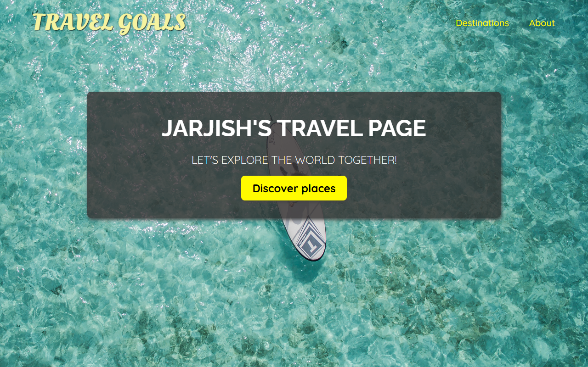
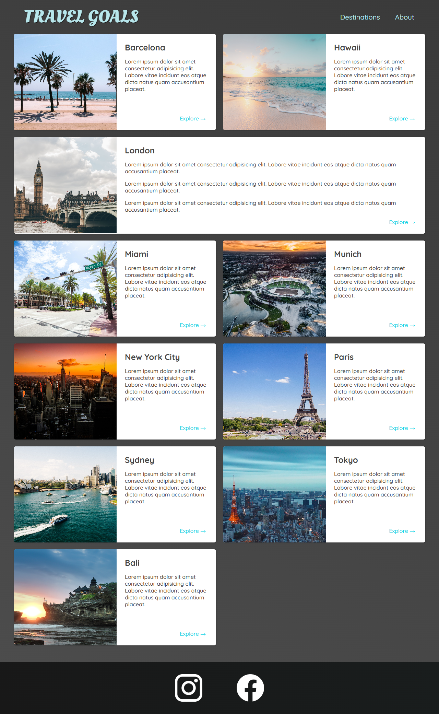
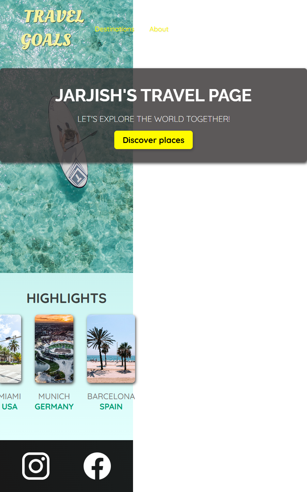

# Travel Goals

A two-page static travel website built with plain HTML and CSS while learning layout, typography and responsive design.



## Pages

- **Home** (`index.html`): full-screen hero with a call-to-action, and a highlights grid of destinations.
- **Destinations** (`places.html`): a longer list of cities (Barcelona, Hawaii, London, Miami, Munich, New York City, Paris, Sydney, Tokyo, Bali) with a photo and a short note for each.

| Destinations page | On a phone (no mobile-specific rules yet) |
|---|---|
|  |  |

## What I practised

- Semantic HTML (`header`, `nav`, `main`, `section`) and descriptive `alt` text on every image.
- CSS split across `shared.css` (header and layout shared by both pages), `styles.css` (home) and `places.css` (destinations).
- Flexbox for the header and hero, and CSS grid for the destinations list.
- Google Fonts (Raleway, Oleo Script, Quicksand).

## Run it

The pages use root-relative links (`/index.html`, `/shared.css`), so serve the folder rather than opening the file directly:

```powershell
python -m http.server 8000
```

Then open http://localhost:8000.

## Project structure

```text
index.html        Home page
places.html       Destinations page
shared.css        Header and layout shared by both pages
styles.css        Home page styles
places.css        Destinations page styles
images/           Photos and icons
```
